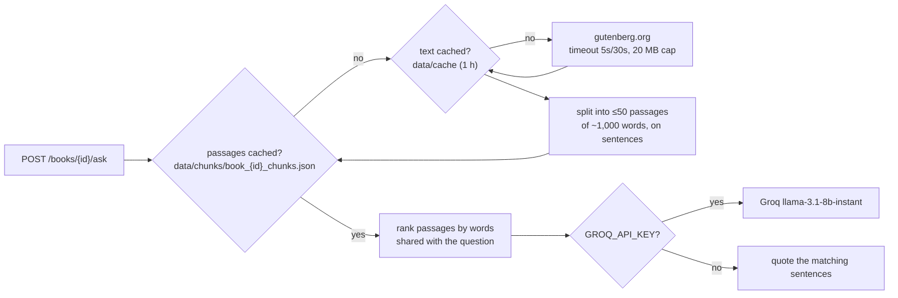

# Gutenberg API

A FastAPI backend for reading Project Gutenberg books. It fetches a book's
metadata and text from gutenberg.org and pages the text. It also answers
questions about the book, scores its sentiment, measures its readability
and reads passages aloud. It was built to serve a separate web frontend
(Project Gutenberg Explorer), but it works fine on its own.

FastAPI, requests + BeautifulSoup, LangChain with Groq, NLTK, edge-tts.

**It runs with no API key.** Without `GROQ_API_KEY`, questions are answered
by quoting the book itself, not by a model. Every line of the answer
appears word for word in the text, and the answer says so.

## Run it

```bash
cp .env.example .env        # optional; add a Groq key for written answers
docker compose up -d --build
```

The API is on **http://localhost:8600**, with interactive docs at `/docs`.

The image build installs Python packages from PyPI and the NLTK data used
for sentiment (stopwords, VADER lexicon, WordNet) from NLTK's download
server. To build without that second download, pass
`--build-arg NLTK_DOWNLOAD=0`; everything except `/sentiment` still works,
and that endpoint answers 503 with the fix.

Without Docker (Python 3.12):

```bash
python -m venv .venv && . .venv/bin/activate
pip install -r requirements.txt -c requirements.freeze.txt
python scripts/download_nltk_data.py      # only needed for /sentiment
uvicorn main:app --reload
```

## Tests and lint

```bash
docker compose --profile test run --rm --build tests
```

This runs 106 tests and `ruff check` in a container with networking
disabled. Gutenberg, Groq and edge-tts are all stubbed. The tests serve
a short synthetic book, so nothing contacts gutenberg.org or Microsoft,
and NLTK is replaced by stand-in resources.

## Endpoints

| Endpoint | Purpose |
|---|---|
| `GET /books/{id}` | Metadata scraped from gutenberg.org |
| `GET /books/{id}/content` | The text, in 500-word pages |
| `GET /books/{id}/readability` | Flesch Reading Ease of the opening pages, or `null` |
| `POST /books/{id}/ask` | Answer a question from the book's text |
| `GET`/`POST /books/{id}/sentiment` | VADER sentiment and word frequencies (background job) |
| `POST /tts` | MP3 of up to 5,000 characters via edge-tts |
| `POST /tts/chunks` | Split text into sentence-aligned pieces for `/tts` |
| `DELETE /cache/{id}`, `DELETE /cache` | Drop cached book text |
| `GET /health` | Liveness |

`{id}` is a Gutenberg ebook number. Anything other than a positive integer is
rejected with 422 before it reaches the scraper or a cache path.

## Examples

These were captured from the app with networking disabled and a synthetic
book served in place of gutenberg.org. That book is ebook 99999, "The
Lighthouse Keeper", which is also the test fixture. Against the real site,
the same calls return the real book.

```
GET /books/99999 -> 200
{
  "id": "99999",
  "title": "The Lighthouse Keeper",
  "author": "Wren, Elsie",
  "language": "English",
  "category": "Lighthouses -- Fiction, Storms -- Fiction",
  "ebook_no": "99999",
  "release_date": "Jan 1, 2001",
  "summary": "A keeper holds a lantern through a storm.",
  "cover_url": "https://www.gutenberg.org/cache/epub/99999/pg99999.cover.medium.jpg",
  "downloads": 1234,
  "reading_ease_score": 82.4,
  "content": null
}
```

`reading_ease_score` here is the figure Gutenberg prints on the book's page.
`/readability` computes its own from the text:

```
GET /books/99999/readability -> 200
{
  "book_id": 99999,
  "reading_ease_score": 85.3,
  "reading_ease_label": "Easy",
  "words": 122,
  "sentences": 11,
  "words_per_sentence": 11.1,
  "syllables_per_word": 1.3
}
```

With no Groq key, the answer is quoted from the book:

```
POST /books/99999/ask  {"query": "What did Mara carry up the tower?"} -> 200
{
  "query": "What did Mara carry up the tower?",
  "response": "From the book's own text:\n\n> Mara carried a lantern to the top of the tower and held it until dawn.\n\n> Mara kept the lighthouse on the northern rock for eleven winters.\n\n_Answered without a language model: passages are selected from the book's text, not generated. Set GROQ_API_KEY for a written answer._",
  "book_id": 99999,
  "processing_time": "0.00 seconds"
}
```

```
GET /books/abc -> 422
{"detail": [{"type": "int_parsing", "loc": ["path", "book_id"], "msg": "Input should be a valid integer, unable to parse string as an integer", "input": "abc"}]}
```

The first `/sentiment` call for a book starts the analysis and returns
`"status": "processing"` with zeroed scores. Poll it until `"status":
"completed"`, which then carries `sentiment` (positive / negative / neutral /
compound averages and an `overall` label) and the top 150 lemmatised words
in `wordcloud_data`. Polling while the job runs does not start another one.
Without the NLTK data, the endpoint returns this:

```
GET /books/99999/sentiment -> 503
{"detail": "NLTK data is missing; run `python scripts/download_nltk_data.py`."}
```

## How a question is answered



The three passages that share the most words with the question go to the
model, in book order. If none share any words, the opening, middle and
closing passages are used instead.

## Design notes

**Extractive answers when there is no model.** These are questions about
the text of a particular book, so the answer should come from that book. A
stand-in that wrote its own prose would show the very failure that
retrieval over documents is meant to prevent. The offline summary is the
opening of the text, and it says so.

**Caches are plain data.** Book text, passages and sentiment results are
JSON files under `DATA_DIR` (default `./data`), and every filename is built
from an integer book ID. Passages used to be stored as pickles, and loading a
pickle can run code. Old `.pkl` files are no longer read.

**No network at import or request time except gutenberg.org, Groq and
edge-tts.** NLTK data is installed ahead of time by
`scripts/download_nltk_data.py`. Earlier versions downloaded it on import,
so the API could not start at all without outbound access.

**Readability is a real measurement.** Flesch Reading Ease is
`206.835 − 1.015 × (words/sentences) − 84.6 × (syllables/words)`, computed
over the first 20,000 words. Word and sentence counts come from the same
span, and a sentence may end inside a closing quote (`"Off with her head!"
said the Queen.`). `null` means "not measurable" and is never replaced by a
default.

**Blocking work stays off the event loop.** Endpoints that fetch from
Gutenberg or touch the disk are plain functions, so FastAPI runs them in its
threadpool.

## Configuration

| Variable | Default | Effect |
|---|---|---|
| `GROQ_API_KEY` | unset | Enables written answers; placeholders like `your_groq_api_key_here` count as unset |
| `CORS_ORIGINS` | `*` | Comma-separated allowed origins (compose sets `http://localhost:3600`) |
| `DATA_DIR` | `./data` | Cache location; `vercel.json` points it at `/tmp` |
| `NLTK_DATA` | NLTK default | Where NLTK data is looked up (`/app/.nltk` in the image) |
| `LOG_LEVEL` | `INFO` | Python logging level |

## Deployment

- **Docker**: the `runtime` stage runs uvicorn as a non-root user, and only
  `/app/data` is writable.
- **Procfile hosts** (Heroku, Koyeb and similar) run
  `uvicorn main:app --port $PORT`.
- **Vercel**: `vercel.json` builds `main.py`.
- **AWS Lambda**: use `main.handler` (Mangum).

## Known limitations

- **Sentiment takes a while on a full novel.** It samples up to 1 MB of
  text, 50,000 words and 300 sentences, so it describes the book's overall
  tone, not every chapter.
- **Passage ranking is lexical.** A passage can answer a question without
  sharing any words with it, and then it will not be picked.
- **The cache is per-process and on local disk.** Separate instances each
  download their own copy of a book. Anyone who can reach the API can also
  call the `DELETE /cache` endpoints, which have no authentication.
- **Scraping depends on gutenberg.org's HTML.** If the page layout changes,
  metadata fields fall back to `"N/A"`.

## Licence

MIT; see [LICENSE](LICENSE).
